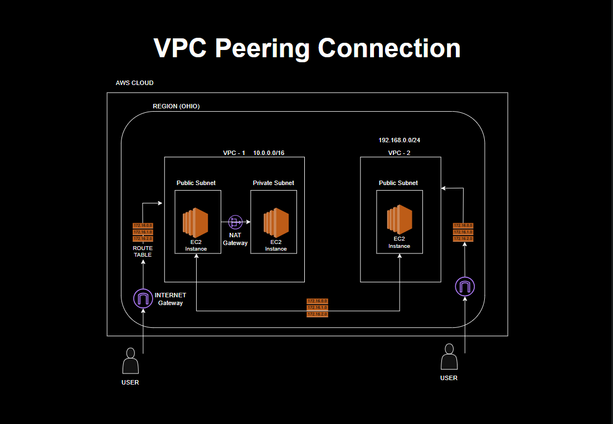

# 🌐 AWS VPC Peering Project

This project demonstrates how to set up **secure communication between two Virtual Private Clouds (VPCs)** using **AWS VPC Peering**. As a DevOps learner, this helped me understand cloud networking, routing, and AWS infrastructure cost management.

---

## 📌 Project Overview

- ✅ Created two VPCs (`Prod-VPC` and `Test-VPC`) in different CIDR ranges
- ✅ Launched EC2 instances in each VPC (public & private subnets)
- ✅ Enabled communication using **VPC Peering**
- ✅ Configured route tables and security groups
- ✅ Set up **NAT Gateway** for private subnet internet access
- ✅ Monitored **AWS Billing & Cost Explorer**
- ✅ Documented the learning and architecture clearly

---

## 🧱 Architecture Diagram

---

## 🚀 AWS Services Used

| Service           | Purpose                                      |
|------------------|----------------------------------------------|
| **VPC**          | Create isolated cloud networks               |
| **EC2**          | Launch test instances                        |
| **VPC Peering**  | Enable cross-VPC communication               |
| **NAT Gateway**  | Allow private subnets to access internet     |
| **Elastic IP**   | Used for NAT Gateway                         |
| **Security Groups** | Control inbound/outbound traffic         |
| **Route Tables** | Define traffic routing between VPCs          |
| **Cost Explorer**| Track and analyze project costs              |

---

## 📸 Project Screenshots

All key components have been captured and added to the [`/screenshots`](./screenshots) folder, including:

- EC2 Instances
- Subnets
- Route Tables
- VPC Peering Connection
- NAT Gateway
- Elastic IP
- Internet Gateway
- Security Groups
- Cost Explorer & Billing Breakdown

---

## 💡 Key Learnings

- 🌐 How VPC Peering enables private communication across VPCs
- 📶 Difference between public and private subnets
- 🔐 Setting up correct routing and security groups
- 💰 AWS Free Tier limitations and cost traps (e.g. NAT Gateway, Elastic IP)
- 🧠 Importance of deleting unused resources to avoid billing
- 📁 Documenting infrastructure to showcase DevOps skills

---

## 🧑‍💻 Author

**PRINCE KUMAR**
